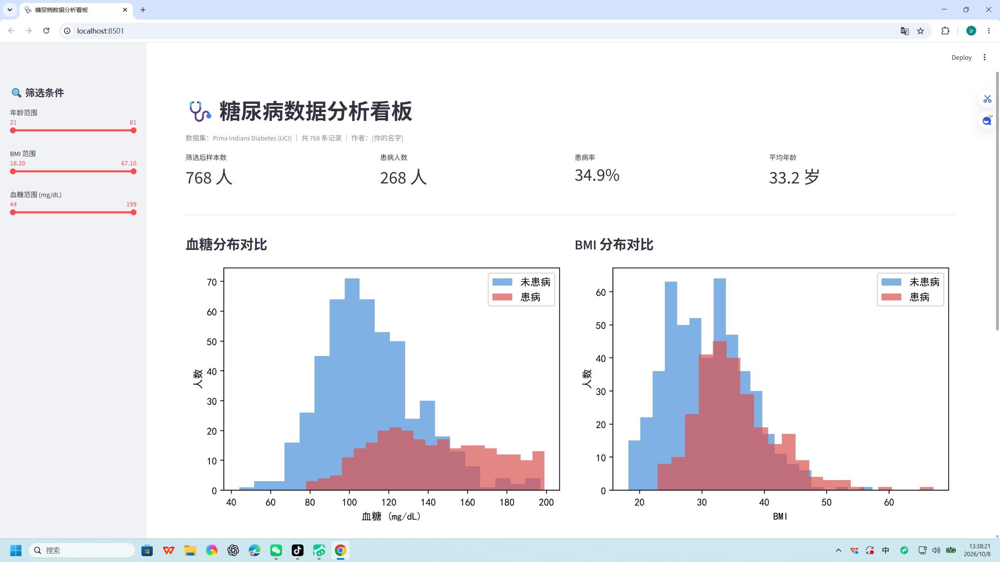
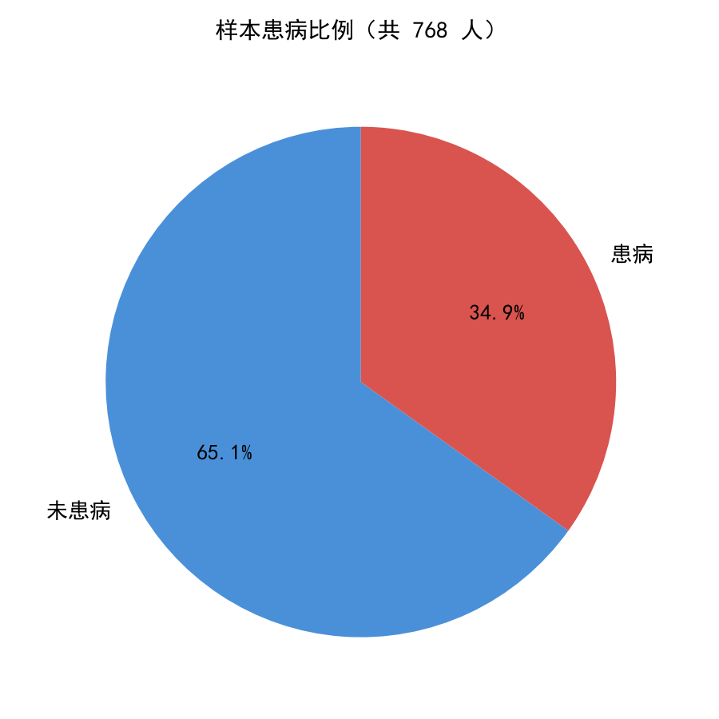
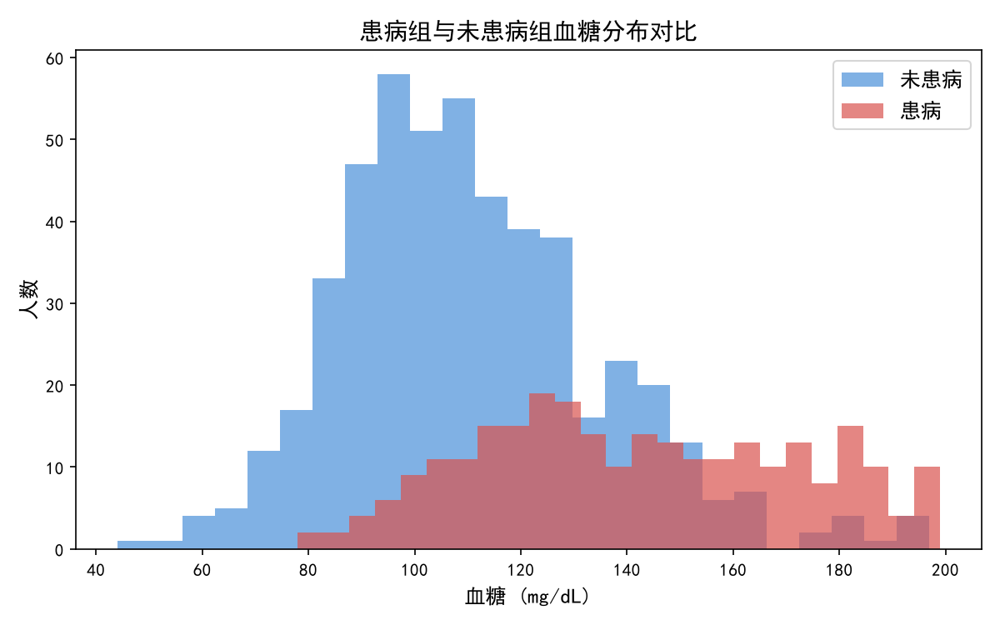
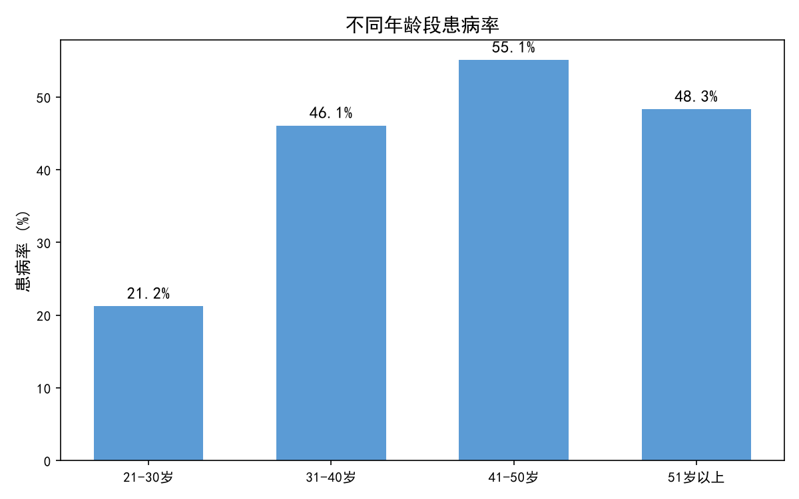
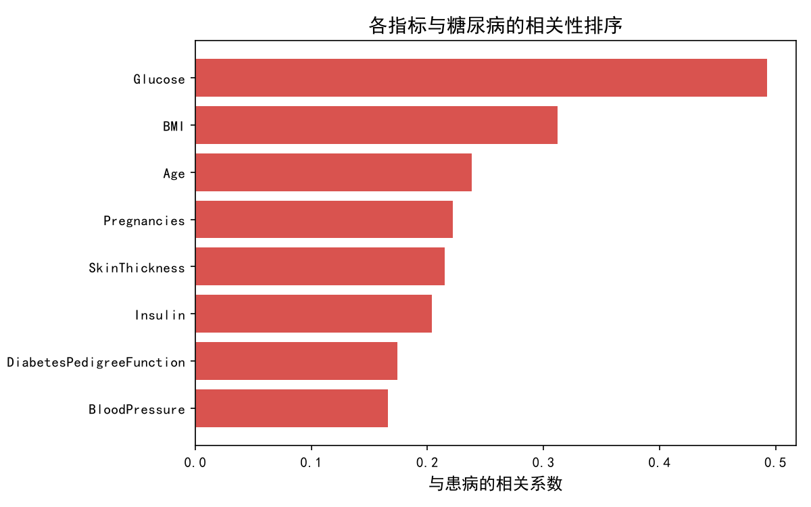

# 糖尿病数据分析与可视化系统

基于 Python 对 Pima Indians Diabetes 数据集进行完整的数据分析全流程实践，包含数据清洗、统计分析、可视化与交互式看板。

## 项目简介

本项目使用公开医疗数据集（UCI Pima Indians Diabetes，768 条记录），完成从原始数据到可视化看板的完整分析流程，重点解决原始数据中"缺失值伪装成 0"的数据质量问题。

## 技术栈

| 技术 | 用途 |
|---|---|
| Python 3.13 | 主语言 |
| pandas | 数据读取、清洗、分组统计 |
| matplotlib | 静态图表绘制 |
| Streamlit | 交互式数据看板 |
| scipy | 显著性检验（t 检验、相关系数检验） |
| statsmodels | 逻辑回归与 OR 值计算 |

## 项目结构

```
diabetes_project/
├── data/
│   ├── pima_diabetes.csv         # 原始数据（无表头）
│   ├── diabetes.csv              # 加表头后数据
│   ├── diabetes_clean.csv        # 清洗后数据
│   ├── diabetes_deidentified.csv # 脱敏后数据（06 产出）
│   └── followup_plan.csv        # 随访计划表（09 产出）
├── images/                       # 生成的图表
│   ├── 1_患病比例.png
│   ├── 2_血糖分布对比.png
│   ├── 3_年龄患病率.png
│   ├── 4_相关性排序.png
│   └── 5_交互看板.png
├── docs/                         # 各步骤产出的报告
│   ├── quality_report.md         # 05 数据质量报告
│   ├── privacy_report.md         # 06 脱敏与合规报告
│   ├── inference_report.md       # 07 统计推断报告
│   ├── followup_report.md       # 09 随访队列报告
│   └── 报告.html                 # 08 面向非技术人的分析报告
├── 01_clean.py                   # 数据清洗
├── 02_analyze.py                 # 统计分析
├── 03_visualize.py               # 静态可视化
├── 04_app.py                     # 交互式看板
├── 05_quality_report.py          # 数据质量体检
├── 06_privacy.py                 # 脱敏与合规检查
├── 07_inference.py               # 统计推断（显著性 / OR 值）
├── 08_report.py                  # 面向非技术人的 HTML 报告
├── 09_followup.py                # 慢病随访队列与提醒
├── prepare_data.py               # 数据预处理
├── requirements.txt              # 依赖清单
└── README.md
```

## 快速开始

```bash
# 1. 安装依赖
pip install -r requirements.txt

# 2. 依次运行
python prepare_data.py     # 加表头，生成 data/diabetes.csv
python 01_clean.py         # 清洗，生成 data/diabetes_clean.csv
python 02_analyze.py       # 输出分析报告
python 03_visualize.py     # 生成图表到 images/

# 3. 启动交互式看板
streamlit run 04_app.py
```

## 核心工作

整个项目是一条**从原始数据到可执行结论**的流水线，每一步都有产出：

| 步骤 | 脚本 | 做什么 | 产出 |
|---|---|---|---|
| 1 | `prepare_data.py` | 给无表头 CSV 加表头 | `data/diabetes.csv` |
| 2 | `01_clean.py` | 识别 5 列"假 0"并填充 | `data/diabetes_clean.csv` |
| 3 | `02_analyze.py` | 分组统计与相关性分析 | 控制台报告 |
| 4 | `03_visualize.py` | 绘制静态图表 | `images/` 4 张 |
| 5 | `04_app.py` | 交互式看板 | Streamlit 页面 |
| 6 | `05_quality_report.py` | **数据质量体检**：区分三类问题 | `docs/quality_report.md` |
| 7 | `06_privacy.py` | **脱敏与合规**：字段分级 + k-匿名 + 抑制 | `docs/privacy_report.md` + 脱敏数据 |
| 8 | `07_inference.py` | **统计推断**：显著性检验 + OR 值 | `docs/inference_report.md` |
| 9 | `08_report.py` | **非技术报告**：给管理者看的结论 | `docs/报告.html` |
| 10 | `09_followup.py` | **随访队列**：风险分层 + 逾期预警 | `docs/followup_report.md` + 随访表 |

后 5 步是从"课程作业"升级到"作品"的关键——**它们回答的是
"这个结论可信吗"、"能不能给别人用"、"接下来该做什么"**。

## 主要发现

### 描述统计层面

- **患病率**：768 人中 268 人患病，占比 34.9%
- **血糖是最强指标**：与患病相关系数 +0.493（强相关），患病组平均血糖 142.1 mg/dL，
  比未患病组（110.7 mg/dL）高 31.4 mg/dL
- **BMI 次之**：相关系数 +0.312（强相关），患病组平均 BMI 35.4，未患病组 30.9
- **年龄效应显著**：21-30 岁患病率 21.2%，31-40 岁升至 46.1%，41-50 岁达 55.1%

### 统计推断层面（关键）

**前面 8 个指标单看时全部显著，但放进同一个模型控制互相影响后，只剩 4 个独立成立。**

| 指标 | 多因素 OR | 95% CI | p 值 | 结论 |
|---|---|---|---|---|
| 血糖 | 3.17 | [2.51, 3.99] | 2.9e-22 | 独立风险因素 |
| 体质指数 | 1.91 | [1.50, 2.43] | 1.4e-07 | 独立风险因素 |
| 妊娠次数 | 1.52 | [1.23, 1.89] | 1.2e-04 | 独立风险因素 |
| 家族史评分 | 1.34 | [1.10,1.62] | 3.2e-03 | 独立风险因素 |
| 年龄 | 1.17 | [0.94, 1.45] | 0.17 | 不独立 |
| 皮褶厚度 | 1.03 | [0.82, 1.29] | 0.79 | 不独立 |
| 血清胰岛素 | 0.90 | [0.75, 1.09] | 0.30 | 不独立（受缺失填充影响） |
| 舒张压 | 0.89 | [0.73, 1.09] | 0.28 | 不独立 |

**临床含义**：年纪大的人确实更容易得糖尿病，但这个效应**大部分是通过血糖和 BMI 中介的**——
控制了这两项之后，年龄本身不再独立显著。所以筛查应该盯**血糖和 BMI**，而不是按年龄划线。

> 统计口径：8 个指标统一做 z-score 标准化，OR 读作「每升高 1 个标准差，患病几率乘以多少」；
> 多重比较用 Bonferroni 校正，α 从 0.05 收紧到 0.0063（不校正的话，
> 8 个指标里至少撞出一个假阳性的概率约 34%）。

## 可视化结果

### 交互式数据看板（Streamlit）



支持按年龄、BMI、血糖三个维度实时筛选，指标卡与图表联动更新。

### 静态分析图表

**1. 样本患病比例**



### 2. 患病组与未患病组血糖分布对比



### 3. 不同年龄段患病率



### 4. 各指标与糖尿病的相关性排序



## 数据局限声明

本数据集仅包含美国皮马印第安女性样本，样本量 768 条，**结论不可直接外推到其他人群**。
分析结果仅供学习与演示用途。

## 数据来源

UCI Machine Learning Repository — Pima Indians Diabetes Database (ID: 34)
https://archive.ics.uci.edu/dataset/34/diabetes
