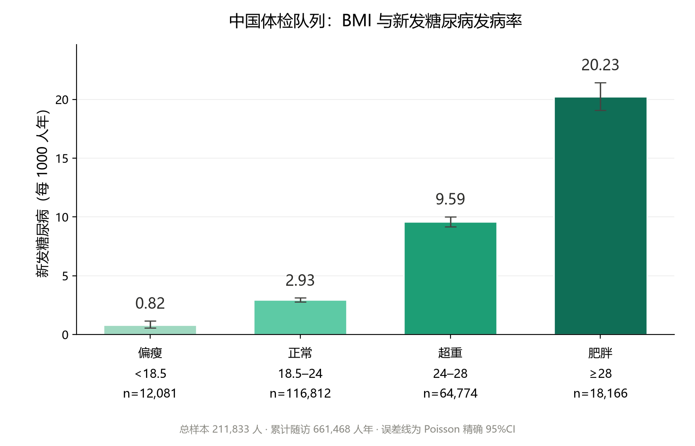
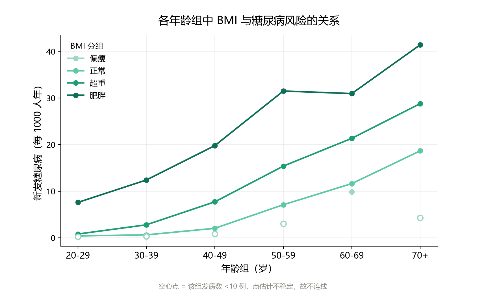
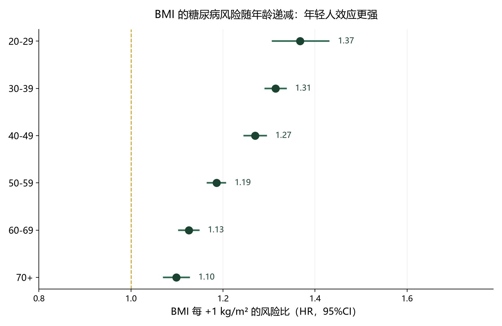

# 中国体检队列 · 糖尿病风险分析

> 用 **21 万人的中国体检队列**（CC0 公开数据），完整走一遍数据分析全流程：审计 → 计划 → 清洗 → 描述 → Cox 回归 → 效应修饰 → 敏感性 → 交付。

**一句话结论**：在中国成年人中，BMI 每升高 1 kg/m²，新发糖尿病风险增加 **21%（HR 1.21，95%CI 1.20–1.22）**，且这一效应随年龄递减（20–29 岁 HR 1.37 vs 70+ 岁 HR 1.10），结论经 6 条敏感性分析验证稳健。

---

## 数据

| 项目 | 值 |
|---|---|
| 来源 | 瑞慈体检 2010–2016 中国 11 城体检队列（Dryad，DOI `10.5061/dryad.ft8750v`，**CC0 1.0**） |
| 原始出处 | *BMJ Open* 2018;8:e021768 |
| 样本 | **211,833 人** |
| 随访 | 661,468 人年（中位 3.12 年） |
| 结局 | 新发糖尿病 4,174 例（6.31 / 1000 人年） |

> 数据免申请、可商用、含随访时间（可做生存分析）。原始 27MB xlsx 与 20MB csv 因体积大**不入库**，见 `data/raw_china/`（本机）与 `00_import_china.py`（导入脚本）。

## 技术栈

Python · pandas · numpy · statsmodels（PHReg Cox 回归）· matplotlib · scipy · Streamlit

## 完整流程（8 步，每步一个脚本 + 一份报告）

| 步骤 | 脚本 | 产出 | 核心结论 |
|---|---|---|---|
| 1 审计 | `c1_audit.py` | `docs/china_审计报告.md` | 5 个坑：结局选错列、血糖截断、缺失不能删、用人年、站点调整 |
| 2 计划 | `c2_plan.py` | `docs/china_分析计划.md` | 跑数据前写死模型序列 + 6 条敏感性 |
| 3 清洗 | `c3_clean.py` | `docs/china_清洗日志.md` | 主模型变量 0% 缺失，无需插补 |
| 4 描述 | `c4_describe.py` | `docs/china_表1.md` + fig1/fig2 | BMI 梯度 24.7 倍，效应被年龄修饰 |
| 5 Cox | `c5_cox.py` | `docs/china_表2_Cox回归.md` | **HR 1.21，独立于代谢指标** |
| 6 效应修饰 | `c6_effect_mod.py` | `docs/china_表3_效应修饰.md` + fig3 | **年龄分层 HR 1.37→1.10，交互 p=9e-48** |
| 7 敏感性 | `c7_sensitivity.py` | `docs/china_表4_敏感性分析.md` | 6 条全扛住，HR 稳在 1.21±2% |
| 8 交付 | `run_all.py` + `04_app.py` | `docs/china_总报告.md` + 看板 | 可复现、可演示 |

## 快速开始

```bash
# 1. 安装依赖
pip install -r requirements.txt

# 2. 准备数据（需先有 data/raw_china/ 下的原始 xlsx）
python 00_import_china.py        # xlsx → china_analysis.csv
python c3_clean.py               # 派生变量 + 清洗日志

# 3. 一键重跑全部分析与图表（c4 → c7）
python run_all.py

# 4. 打开交互式看板
streamlit run 04_app.py
```

## 核心图表

**图 1 · BMI 分组发病率**（四组区间互不重叠，梯度 24.7 倍）



**图 2 · 年龄 × BMI 分层**（率比随年龄从 18.3 掉到 2.2，绝对风险差反向走）



**图 3 · 年龄分层 HR 森林图**（HR 从 1.37 单调降到 1.10）



## 三个方法论亮点

1. **分析计划写成代码**（`c2_plan.py`）——跑数据前写死研究问题、模型序列、敏感性清单，杜绝"跑完再换模型凑显著"。
2. **有随访时间就用 Cox，不用 logistic**——logistic 会把"随访 2 年发病"和"7 年没病"当同一件事，浪费 75% 信息量。
3. **不硬凑**——切点敏感性里偏瘦组仅 31 个事件、分类 Cox 不收敛，就改用率比：知道什么时候该换方法，比会用方法更值钱。

## 诚实边界

- 观察性队列，结论是**关联**而非**因果**（可能有未测量混杂）
- 结局 = FPG≥7.0 或自报医生诊断，未做 OGTT 确认
- 体检人群可能比一般人群更健康（健康体检者偏倚）

---

*本仓库同时保留一个更早期的 Pima Indians（768 条）教学项目（`01_clean.py` 等脚本），用于对比"小样本逻辑回归"与"大队列生存分析"两种方法。*
